<div align="center">

# 🌻 GitFarm

**Your contribution graph, but it's a farm.**
A little pixel-art farmer walks your last year of GitHub activity, tills every day,
and plants a crop wherever you committed. The more you code, the bigger the harvest.



</div>

## How it grows

| Your day | On the farm |
| --- | --- |
| No contributions | Tilled soil… and sometimes weeds 🌿 |
| A few | A sprout 🌱 |
| Some | A young plant |
| Many | A fully grown crop |
| Your best days | Harvest-ready, with a little sparkle ✨ |

The crop depends on your most-used language:

| Language | Crop |
| --- | --- |
| Python, Jupyter | 🌽 Corn |
| JavaScript, TypeScript, HTML, CSS, Vue, Svelte | 🌻 Sunflower |
| Rust, Go, Ruby, PHP | 🍅 Tomato |
| C, C++, C#, Java, Kotlin, Swift | ☕ Coffee |
| Everything else | 🌾 Wheat |

Don't like your crop? Pick one with `crop: tomato`.

## Animals 🐔🐄🐕

Your **longest streak of the year** unlocks animals. They live in the pasture below the field,
and a little sign tells you how many days you need for the next one.

| Best streak | Unlocks |
| --- | --- |
| 7 days | 🐔 A chicken (one more every 7 days, up to 3) |
| 30 days | 🐄 A cow |
| 100 days | 🐕 A dog that follows the farmer around |

Longest streak, not current: breaking your streak never takes your animals away.

## Plant your own farm (2 minutes)

**1.** In your profile repo (`your-username/your-username`), create `.github/workflows/farm.yml`:

```yaml
name: Plant my farm

on:
  schedule:
    - cron: "17 3 * * *" # every day
  workflow_dispatch:
  push:
    branches: [main]

permissions:
  contents: write

jobs:
  farm:
    runs-on: ubuntu-latest
    steps:
      - uses: YOUR_GITHUB_USER/gitfarm@v1
        with:
          github_user_name: ${{ github.repository_owner }}
          output: dist/farm.svg
          # crop: auto   # or corn, sunflower, tomato, coffee, wheat

      - uses: crazy-max/ghaction-github-pages@v4
        with:
          target_branch: output
          build_dir: dist
        env:
          GITHUB_TOKEN: ${{ secrets.GITHUB_TOKEN }}
```

**2.** Run it once from the **Actions** tab (or wait for the daily run).

**3.** Add this to your `README.md`:

```md

```

That's it. Your farm replants itself every day.

## Inputs

| Input | Default | Description |
| --- | --- | --- |
| `github_user_name` | repo owner | Whose contributions grow on the farm |
| `github_token` | `github.token` | Used to read the contribution calendar |
| `output` | `dist/farm.svg` | Where the SVG is written |
| `crop` | `auto` | `auto`, `corn`, `sunflower`, `tomato`, `coffee` or `wheat` |

## Run it locally

No dependencies, just Node 20+:

```bash
node src/cli.js --user your-username --out farm.svg          # real data (token optional: --token or GITHUB_TOKEN)
node src/cli.js --demo --user octocat --crop corn --out demo.svg  # fake data, no network
node src/cli.js --demo --user octocat --streak 100 --out demo.svg # preview all animals
```

## How it works

The SVG is pure pixel art drawn with `<rect>`s, animated with CSS keyframes only (no JavaScript),
so it renders inside GitHub READMEs. Each plot gets a keyframe for the moment the farmer reaches it,
and the whole field fades and replants in a loop.

## Ideas / roadmap

- 🌙 Day/night cycle based on when you usually commit
- 🍂 Seasons that follow the calendar
- 🎨 More crops (PRs with new sprites are very welcome!)

## License

MIT © David Felipe Beltrán Tabares
